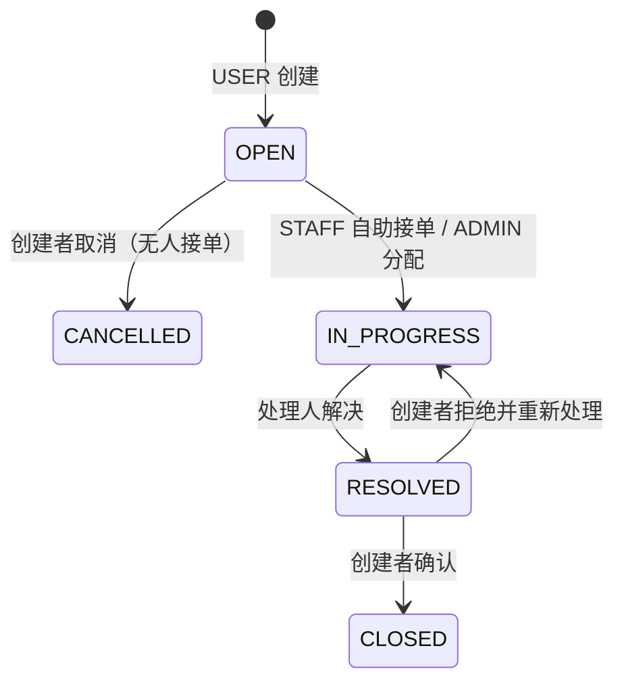

# FixFlow 系统结构与权限设计

## 整体架构

```mermaid
flowchart LR
    U[浏览器 Vue 3] -->|HTTP| N[Nginx 80]
    N -->|/api/*| B[Spring Boot 4]
    B --> A[Sa-Token 身份验证]
    B --> S[工单/用户/审计 Service]
    S --> M[MyBatis-Plus]
    M --> DB[(MySQL 8)]
    S -->|@Audit AOP| AUD[独立审计事务]
    AUD --> DB
    B --> H[Actuator Health]
    CI[GitHub Actions] -->|测试完成后| R[Windows 自托管 Runner]
    R -->|Compose 版本化镜像| N
    R --> B
```

- Docker Compose 内网隔离后端和 MySQL，前端 Nginx 只把 `127.0.0.1:8081` 发布到宿主机。
- `Sa-Token` 全局拦截 `/api/**`，注册、登录和退出登录有白名单；管理员/工作人员接口额外通过 `@SaCheckRole` 校验。
- `@Audit` 通过 AOP 环绕通知调用独立事务写入日志。匿名登录失败允许 `audit_log.user_id = NULL`；操作人显示“匿名用户”。
- 审计服务异常由切面记录，不能覆盖业务原始异常；**审计不可用时不能保证日志完整**，生产环境需要额外告警与事件队列。
- MySQL 条件更新在事务内部完成工单状态竞争，历史记录与状态变更在同一业务事务内提交。

## 工单状态机（本阶段调整后的业务契约）



`CLOSED`/`CANCELLED` 无继续流转；关闭和重新打开都带有 `WHERE status='RESOLVED' AND creator_id=?` 等条件，确保并发竞争不能同时成功。处理人不能代表创建者确认关闭。网页按钮只是方便操作，实际权限由后端校验。

## 新的分页 API

对原有列表 API 保持兼容，增加 `/page` 后缀：

| 接口 | 角色 | 返回类型 | 默认分页 |
|---|---|---|---|
| `GET /api/ticket/my-tickets/page` | 登录用户 | `PageResult<TicketVO>` | current=1,pageSize=10 |
| `GET /api/ticket/open/page` | STAFF/ADMIN | `PageResult<TicketVO>` | 同上 |
| `GET /api/ticket/assigned/page` | STAFF/ADMIN | `PageResult<TicketVO>` | 同上 |

分页上下限是 current ≥ 1、1 ≤ pageSize ≤ 100。工单列表批量获取分类和创建者，避免每条记录单独查询创建者。旧无分页 API 为兼容而保留，不建议新客户端继续使用。
